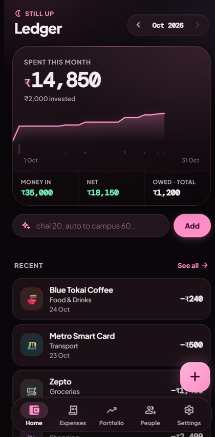

<div align="center">

# 💳 Ledger — Personal Expense & Investment PWA

<p><strong>A mobile-first, zero-framework progressive web application for real-time personal finance tracking, portfolio monitoring, and Gemini-powered expense parsing.</strong></p>

[](https://personal-expense-dash.vercel.app)
[](https://vercel.com)
[](https://personal-expense-dash.vercel.app)
[](https://supabase.com)
[](https://ai.google.dev)
[](LICENSE)

<br />

<a href="https://personal-expense-dash.vercel.app">
  
</a>

<br /><br />

[**Launch Live App ↗**](https://personal-expense-dash.vercel.app)

</div>

---

## 🚀 Overview

**Ledger** is a high-performance, single-file Progressive Web App (PWA) designed to eliminate friction in daily financial accounting. Built without heavy JS frameworks, it opens instantly, runs offline via service workers, and syncs seamlessly with **Supabase (PostgreSQL)**.

Natural language spending inputs (e.g., *"chai 20, auto to campus 60"*) are parsed and categorized in real time using the **Google Gemini API**, while a reactive dark liquid-glass UI makes monitoring your net worth, investments, and group debts effortless.

---

## ✨ Key Features

- **⚡ Instant Single-File PWA:** Fully contained within a standalone `index.html` file with service worker caching (`sw.js`) and PWA installation support for iOS and Android home screens.
- **🧠 Natural-Language Quick Add (Gemini AI):** Type or dictate messy daily expenses; Gemini's generative language model parses amount, category, merchant, and notes automatically.
- **📩 SMS Gap Detection:** Reconciles offline or external transactions by cross-referencing recent payment alerts with logged expenses to ensure zero missing records.
- **📈 Portfolio & Asset Holdings:** Real-time visibility into equity, mutual funds, gold, and debt holdings with automated P&L calculations and asset allocation bars.
- **🤝 Debt & Reimbursement Tracker:** Keeps tabs on split expenses, roommates, and household bills with one-click settlement matching.
- **🎨 Liquid-Glass Design System:** Responsive dark theme based on Material 3 tokens, featuring smooth swipe actions, undo snackbars, and notch/safe-area compatibility.

---

## 🛠️ Tech Stack

| Layer | Technology |
|---|---|
| **Frontend & UI** | Pure Vanilla HTML5 / CSS3 / ES6+ (Single-file architecture) |
| **PWA & Offline** | Web App Manifest (`manifest.json`) · Service Worker (`sw.js`) Cache API |
| **Database & Auth** | [Supabase](https://supabase.com) (PostgreSQL with Row-Level Security) |
| **Natural Language AI**| [Google Gemini API](https://ai.google.dev) (`generativelanguage.googleapis.com`) |
| **Typography & Icons** | Plus Jakarta Sans · DM Mono · Material Symbols Rounded |
| **Hosting & CI/CD** | [Vercel](https://vercel.com) (Continuous zero-config deployment) |

---

## 🗄️ Database Schema (Supabase)

To replicate the backend tables in your own Supabase project, execute the following in your Supabase SQL Editor:

```sql
-- Ledger talks to PostgREST directly, so these are exactly the columns the app
-- reads and writes. Run once in the Supabase SQL editor.

CREATE EXTENSION IF NOT EXISTS "uuid-ossp";

-- 1. Transactions (money out and money in)
CREATE TABLE IF NOT EXISTS transactions (
    id UUID PRIMARY KEY DEFAULT uuid_generate_v4(),
    type TEXT NOT NULL DEFAULT 'debit' CHECK (type IN ('debit','credit')),
    amount NUMERIC(12, 2) NOT NULL,
    category TEXT,
    merchant_raw TEXT,
    merchant_display TEXT,
    note TEXT,
    txn_date DATE NOT NULL DEFAULT CURRENT_DATE,
    created_at TIMESTAMPTZ NOT NULL DEFAULT NOW(),
    sms_raw TEXT,
    is_reimbursable BOOLEAN NOT NULL DEFAULT FALSE,
    balance_after NUMERIC(12, 2),
    reimbursed_txn_id UUID
);
CREATE INDEX IF NOT EXISTS transactions_date_idx
    ON transactions (txn_date DESC, created_at DESC);
CREATE INDEX IF NOT EXISTS transactions_type_date_idx
    ON transactions (type, txn_date DESC, created_at DESC);

-- 2. Investments & holdings
CREATE TABLE IF NOT EXISTS investments (
    id UUID PRIMARY KEY DEFAULT uuid_generate_v4(),
    name TEXT NOT NULL,
    type TEXT NOT NULL DEFAULT 'mutual_fund',   -- mutual_fund | stock | crypto | other
    source TEXT NOT NULL DEFAULT 'manual',      -- groww | manual
    units NUMERIC(18, 4) NOT NULL DEFAULT 0,
    avg_buy_price NUMERIC(12, 4),
    invested_amount NUMERIC(12, 2) NOT NULL DEFAULT 0,
    current_value NUMERIC(12, 2),
    ticker TEXT,
    mode TEXT NOT NULL DEFAULT 'active',        -- active | long_term_hold
    created_at TIMESTAMPTZ NOT NULL DEFAULT NOW(),
    updated_at TIMESTAMPTZ NOT NULL DEFAULT NOW()
);

-- 3. Debts & reimbursements
CREATE TABLE IF NOT EXISTS people (
    id UUID PRIMARY KEY DEFAULT uuid_generate_v4(),
    name TEXT NOT NULL,
    upi_id TEXT,
    created_at TIMESTAMPTZ NOT NULL DEFAULT NOW()
);

CREATE TABLE IF NOT EXISTS debts (
    id UUID PRIMARY KEY DEFAULT uuid_generate_v4(),
    person_id UUID REFERENCES people(id) ON DELETE CASCADE,
    amount NUMERIC(12, 2) NOT NULL,
    amount_settled NUMERIC(12, 2) NOT NULL DEFAULT 0,
    reason TEXT,
    debt_date DATE NOT NULL DEFAULT CURRENT_DATE,
    status TEXT NOT NULL DEFAULT 'pending' CHECK (status IN ('pending','settled')),
    settled_date TIMESTAMPTZ,
    linked_txn_id UUID,
    created_at TIMESTAMPTZ NOT NULL DEFAULT NOW()
);

-- Household spending your parents pay you back for. `txn_id` links a pending
-- reimbursement to the expense it came from; `settled_txn_id` links the credit
-- that paid it.
CREATE TABLE IF NOT EXISTS household_reimbursements (
    id UUID PRIMARY KEY DEFAULT uuid_generate_v4(),
    txn_id UUID REFERENCES transactions(id) ON DELETE CASCADE,
    amount NUMERIC(12, 2) NOT NULL,
    description TEXT,
    status TEXT NOT NULL DEFAULT 'pending' CHECK (status IN ('pending','settled')),
    settled_date TIMESTAMPTZ,
    settled_txn_id UUID,
    created_at TIMESTAMPTZ NOT NULL DEFAULT NOW()
);

-- Recurring income, used to keep salary/stipend credits out of debt matching.
CREATE TABLE IF NOT EXISTS income_sources (
    id UUID PRIMARY KEY DEFAULT uuid_generate_v4(),
    name TEXT NOT NULL,
    expected_amount NUMERIC(12, 2),
    frequency TEXT DEFAULT 'monthly',           -- monthly | weekly | one_time
    credit_keyword TEXT,
    is_active BOOLEAN NOT NULL DEFAULT TRUE,
    created_at TIMESTAMPTZ NOT NULL DEFAULT NOW()
);

-- Merchant → category memory ("Remember this merchant" in the add sheet).
CREATE TABLE IF NOT EXISTS merchant_mappings (
    raw_name TEXT PRIMARY KEY,
    display_name TEXT,
    category TEXT
);
```

### A note on RLS

This build has **no login flow**: it sends your Supabase anon key straight from the
browser. That means `auth.uid()`-based policies will block every request, while a
permissive `anon` policy would let anyone holding the key read the data.

Practical setup:

- Use a **dedicated Supabase project per person**, keep the anon key private, and
  don't publish a build that has it baked in.
- If you keep RLS enabled, add permissive policies for the `anon` role (otherwise
  the app sees empty tables):

```sql
ALTER TABLE transactions ENABLE ROW LEVEL SECURITY;
-- …repeat for investments, people, debts, household_reimbursements,
--  income_sources and merchant_mappings, then:
CREATE POLICY ledger_all ON transactions FOR ALL TO anon USING (true) WITH CHECK (true);
```

- For a multi-user deployment, add Supabase Auth, a `user_id` column on every
  table, and `USING (auth.uid() = user_id)` policies instead.


---

## 🚀 Getting Started

### Local Development

1. **Clone the repository:**
   ```bash
   git clone https://github.com/NamyaaParmar/personal-expense-dash.git
   cd personal-expense-dash
   ```

2. **Serve locally:**
   ```bash
   # Using Python:
   python -m http.server 8080

   # Or using npx:
   npx serve .
   ```

3. Open **`http://localhost:8080`** in a modern browser.

### Cloud Configuration

1. Create a project at [supabase.com](https://supabase.com), then push the bundled schema:
   ```bash
   npx supabase link --project-ref <project-ref>
   npx supabase db push
   ```
2. Deploy the SMS webhook and give it a shared secret:
   ```bash
   npx supabase functions deploy parse-sms
   npx supabase secrets set WEBHOOK_SECRET=<long-random-string>
   ```
3. In the app settings drawer, configure your:
   - **Supabase URL & Anon Key** (Project Settings → API)
   - **Gemini API Key** *(stored locally in `localStorage`, never sent to any server)*.

### SMS Relay (Android)

`sms_relay.apk` forwards bank SMS to the deployed `parse-sms` function. Install it,
then enter:

- **Supabase Function URL** — `https://<project-ref>.supabase.co/functions/v1/parse-sms`
- **Webhook Secret** — the same `WEBHOOK_SECRET` value

The relay accepts HDFC, IDFC, ICICI, Axis, Kotak, SBI, Yes Bank and PNB sender IDs.
`parse-sms` understands HDFC UPI alerts such as `Sent Rs.366.59 … To <merchant> … On 23/10/26`
and `Rs.700.00 credited … from VPA …`, stores the transaction, and skips duplicate
SMS bodies. The Android source is the separate `SMSRelay` project.

---

## 🔒 Security Best Practices

- **Zero-Backend Storage of AI Keys:** Your Gemini API Key resides strictly inside your browser's `localStorage`, never sent to any server except Google's API.
- **Database Access:** All requests go straight from the browser to Supabase with the anon key you enter in Settings. Keep that key private, use a project that is yours alone, and see [A note on RLS](#a-note-on-rls) before assuming rows are isolated per user — this build ships without a login flow.
- **Data Privacy:** Financial statements and personal transactions are never committed to version control (see `.gitignore`).

---

## 👤 Author

**Kahaan Shah**
- Portfolio: [kahaanshah.in](https://kahaanshah.in)
- GitHub: [@Kahaan83](https://github.com/Kahaan83)
- LinkedIn: [linkedin.com/in/kahaan-shah-842095334](https://www.linkedin.com/in/kahaan-shah-842095334/)

---

## 📄 License

This project is licensed under the MIT License — see the [LICENSE](LICENSE) file for details.
